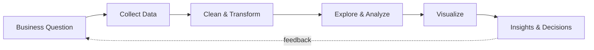

<div align="center">



<a href="https://github.com/chand-khan824">
  
</a>

<br/>


</div>

---

## 👨‍💻 About Me

```python
class ChanduLashari:
    role        = "Full-Stack Data Analyst"
    focus       = ["Data Analysis", "Business Intelligence", "Data Visualization", "Web + Data Apps"]
    languages   = ["Python", "SQL", "JavaScript"]
    tools       = ["Power BI", "Tableau", "Excel", "Jupyter", "Git"]
    mission     = "Turn messy data into decisions people can trust"
    currently   = "Building dashboards, automating reports & exploring ML"
    open_to     = ["Collaborations", "Freelance projects", "Full-time opportunities"]

    def say_hi(self):
        return "Let's build something data-driven together!"
```

### 🎯 What I Do

- 📊 Clean, model and analyze data to uncover patterns that drive business decisions
- 📈 Build interactive dashboards and reports (Power BI, Tableau, Python)
- 🗄️ Write optimized SQL queries and design reliable data pipelines
- 🌐 Develop full-stack data apps — from the database to the browser
- 🤖 Explore predictive analytics and machine learning to go beyond descriptive reports

---

## 🛠️ Tech Stack

<div align="center">

### 🔹 Data Analysis & BI


### 🔹 Visualization & Machine Learning


### 🔹 Full-Stack & Databases


### 🔹 Tools & Workflow


</div>

> 💡 *Tip: remove any badge you don't use, so the profile stays 100% honest and focused.*

---

## 📊 GitHub Analytics

<div align="center">


<br/>


<br/>

</div>

---

## 🚀 Featured Projects

| Project | Description | Tech |
|---|---|---|
| 📈 **[Sales Performance Dashboard](https://github.com/chand-khan824/sales-dashboard)** | Interactive KPI dashboard tracking revenue, growth and regional performance | `Power BI` `SQL` `DAX` |
| 🛒 **[E-Commerce Customer Analysis](https://github.com/chand-khan824/ecommerce-analysis)** | RFM segmentation and churn insights from transactional data | `Python` `Pandas` `Plotly` |
| 🔮 **[Sales Forecasting App](https://github.com/chand-khan824/forecasting-app)** | Time-series forecasting served through a web interface | `Python` `Scikit-learn` `Streamlit` |
| 🗄️ **[ETL Data Pipeline](https://github.com/chand-khan824/etl-pipeline)** | Automated extract-transform-load workflow into a SQL warehouse | `Python` `PostgreSQL` `Docker` |

> ✏️ *Replace the sample rows above with your real projects and links.*

---

## 📌 Data Analysis Workflow



---


## 🌐 Let's Connect

<div align="center">

<a href="https://www.linkedin.com/in/YOUR_LINKEDIN"></a>
<a href="mailto:YOUR_EMAIL@example.com"></a>
<a href="https://YOUR_PORTFOLIO.com"></a>
<a href="https://www.kaggle.com/YOUR_KAGGLE"></a>
<a href="https://public.tableau.com/app/profile/YOUR_TABLEAU"></a>

<br/><br/>


<br/><br/>



</div>
